<picture>
  <source media="(prefers-color-scheme: dark)" srcset="./assets/header-dark.svg">
  <source media="(prefers-color-scheme: light)" srcset="./assets/header-light.svg">
  
</picture>

  
  
  

 

## 👋 About me

I'm a software engineer in **Glasgow** who builds for the web, end to end: interfaces in **React and Next.js**, APIs in **Node and Python**, and the databases behind them. I like turning messy requirements into products that are fast, clear and easy to maintain.

- 🔭 **Right now:** building and shipping production websites with Next.js and TypeScript
- 🌱 **Exploring:** performance, clean API design and developer tooling
- 💬 **Ask me about:** React, Next.js, TypeScript, REST APIs, the MERN stack, smart contracts
- 🤝 **Open to:** freelance work, collaborations and interesting problems

 

## 🛠️ Tech stack

  
    
  

 

## 🚀 Featured projects

<table>
  <tr>
    <td width="50%" valign="top">
      <h3><a href="https://github.com/IbrahimHafez99/crowdfunding-blockchain-based">⛓️ Blockchain Crowdfunding</a></h3>
      
Decentralised crowdfunding: Solidity <code>Campaign</code> and <code>CampaignFactory</code> contracts, a Next.js dApp front end and an Express/MongoDB API.

      
      
      
      
    </td>
    <td width="50%" valign="top">
      <h3><a href="https://github.com/IbrahimHafez99/sycards-mern">🛍️ SyCards Store</a></h3>
      
Full MERN online shop with JWT authentication, image uploads, Redux state management and PayPal checkout.

      
      
      
      
      
    </td>
  </tr>
  <tr>
    <td width="50%" valign="top">
      <h3><a href="https://github.com/IbrahimHafez99/referral-program">🎁 Referral Program</a></h3>
      
Next.js referral platform with a Prisma data layer, JWT authentication and automated emails via Nodemailer.

      
      
      
      
    </td>
    <td width="50%" valign="top">
      <h3><a href="https://github.com/IbrahimHafez99/room-booking-system">🏢 Room Booking API</a></h3>
      
Flask REST API with a modular structure (controllers, repositories, middleware), Pydantic validation and a pytest suite.

      
      
      
    </td>
  </tr>
  <tr>
    <td width="50%" valign="top">
      <h3><a href="https://github.com/IbrahimHafez99/rest-api-best-practices">🧱 REST API Best Practices</a></h3>
      
A typed Express + MongoDB API: Zod schema validation, JWT auth and a clean, layered project layout.

      
      
      
      
    </td>
    <td width="50%" valign="top">
      <h3><a href="https://github.com/IbrahimHafez99/redux-toolkit-blog">📝 Redux Toolkit Blog</a></h3>
      
A React blog app with Redux Toolkit for state management and Axios for talking to the API.

      
      
    </td>
  </tr>
</table>

 

## 📈 GitHub activity

  <picture>
    <source media="(prefers-color-scheme: dark)" srcset="https://streak-stats.demolab.com/?user=IbrahimHafez99&hide_border=true&background=0A0D1A&ring=B57CFF&fire=FF7CC8&currStreakLabel=B57CFF&sideLabels=8B93B5&currStreakNum=F5F7FF&sideNums=F5F7FF&dates=5A6185&stroke=1E2444">
    
  </picture>
  <picture>
    <source media="(prefers-color-scheme: dark)" srcset="./assets/langs-dark.svg">
    
  </picture>

 

  

